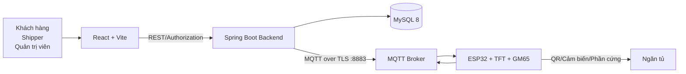

# Smart Locker - Hệ thống tủ giao nhận hàng thông minh


**Smart Locker** là đồ án tốt nghiệp xây dựng hệ thống tủ giao nhận hàng thông minh cho bài toán giao hàng chặng cuối (last-mile delivery). Hệ thống kết nối ba tầng: ứng dụng web cho khách hàng, shipper và quản trị viên; backend Spring Boot quản lý nghiệp vụ và dữ liệu; firmware ESP32 điều khiển từng ngăn tủ, cảm biến và khóa.

> Đơn vị: Khoa Viễn thông 1 - Học viện Công nghệ Bưu chính Viễn thông (PTIT).  
> Nhóm: Nhóm 64 - D22VTHI01.  
> Năm: 2026.

---

## Mục lục

- [Tính năng](#tính-năng)
- [Kiến trúc hệ thống](#kiến-trúc-hệ-thống)
- [Luồng nghiệp vụ](#luồng-nghiệp-vụ)
- [Công nghệ](#công-nghệ)
- [Cấu trúc thư mục](#cấu-trúc-thư-mục)
- [Yêu cầu hệ thống](#yêu-cầu-hệ-thống)
- [Cài đặt nhanh](#cài-đặt-nhanh)
- [Cấu hình môi trường](#cấu-hình-môi-trường)
- [Chạy firmware ESP32](#chạy-firmware-esp32)
- [Kiểm thử MQTT](#kiểm-thử-mqtt)
- [Tài khoản mẫu](#tài-khoản-mẫu)
- [Kiểm thử](#kiểm-thử)
- [Tài liệu](#tài-liệu)
- [Bảo mật](#bảo-mật)

---

## Tính năng

### Khách hàng

- Đăng nhập và xem danh sách bưu kiện của mình.
- Đổi mã QR nhận hàng hoặc nhận OTP có thời hạn.
- Nhận hàng bằng QR hoặc OTP 6 chữ số.
- Xem bản đồ mạng lưới tủ và trạng thái các trạm.

### Shipper

- Tạo đơn, gắn khách hàng và chọn trạm tủ.
- Đặt trước ngăn trong 1 giờ hoặc 2 giờ.
- Xem mã QR định danh shipper và quét mã vận đơn tại tủ.
- Nạp hàng, tra cứu đơn quá hạn và thu hồi bưu kiện.
- Xem lộ trình giao hàng với bản đồ Leaflet/OSRM.

### Quản trị viên

- Theo dõi KPI, số đơn, tình trạng tủ và ngăn.
- Xem sơ đồ ngăn: cửa, cân, cảm biến hồng ngoại và tình trạng hàng.
- Mở ngăn khẩn cấp, bật/tắt bảo trì toàn tủ hoặc từng ngăn.
- Quét đơn quá hạn và xem lịch sử thao tác mở tủ.
- Cấp tài khoản người dùng.

### Nghiệp vụ tự động

- Tự nhả ngăn đặt trước khi hết thời hạn giữ chỗ.
- Chuyển đơn sang `OVERDUE` theo tác vụ nền.
- Cập nhật trạng thái realtime trong web khi có sự kiện tủ.
- Đánh dấu tủ trực tuyến dựa trên nhịp tim MQTT.
- Chỉ chốt đơn nhận hàng khi cửa đã đóng và ngăn thực sự rỗng.

---

## Kiến trúc hệ thống



- **Frontend** cung cấp giao diện và gọi REST API qua `/api`.
- **Backend** giữ toàn bộ nghiệp vụ, phân quyền, MySQL và MQTT.
- **MQTT** dùng để truyền trạng thái tủ, QR, cảm biến và lệnh mở ngăn.
- **Firmware** điều khiển ngăn, màn hình LVGL, mã QR và cảm biến phần cứng.

---

## Luồng nghiệp vụ

1. **Tạo đơn**
   - Shipper tạo đơn cho khách hàng và chọn trạm tủ.
   - Có thể giữ trước một ngăn trong 1 hoặc 2 giờ.

2. **Shipper nạp hàng**
   - Shipper quét mã QR định danh của mình tại tủ.
   - Quét mã vận đơn; hệ thống xác minh đơn và ngăn đã đặt trước.
   - Tủ mở ngăn, shipper bỏ hàng và đóng cửa.

3. **Hệ thống xác nhận nạp**
   - Backend nhận trạng thái cửa, cân và cảm biến hồng ngoại.
   - Khi phát hiện hàng hợp lệ, đơn chuyển sang `DEPOSITED` và ngăn sang `OCCUPIED`.

4. **Khách nhận hàng**
   - Khách nhập OTP hoặc quét mã QR nhận hàng.
   - Backend xác minh mã, gửi lệnh mở đúng ngăn.
   - Đơn hoàn tất khi cửa đã đóng và ngăn không còn vật/hàng.

5. **Đơn quá hạn**
   - Hệ thống chuyển đơn quá hạn sau thời gian lưu quy định.
   - Shipper được phép thu hồi và backend giải phóng ngăn sau xác nhận cửa đóng.

---

## Công nghệ

| Thành phần | Công nghệ chính |
|---|---|
| Frontend | React 19, Vite 8, Tailwind CSS 4, Axios, Leaflet, React-Leaflet, Lucide, `qrcode.react`, Oxlint |
| Backend | Java 21, Spring Boot 4.0.8, Spring Security, Spring Data JPA, Hibernate, Eclipse Paho MQTT, springdoc-openapi |
| Cơ sở dữ liệu | MySQL 8.0 |
| Broker MQTT | EMQX hoặc broker tương thích MQTT over TLS |
| Firmware | ESP32, ESP-IDF, LVGL 9, ILI9341, XPT2046 |
| Phần cứng | GM65 QR Scanner, HX711/loadcell, relay, solenoid 12 V, MC-38, cảm biến hồng ngoại |

---

## Cấu trúc thư mục

```text
DATN-smart-locker-main/
├── frontend/                         # React + Vite
│   ├── src/components/               # Giao diện theo vai trò
│   ├── src/services/                 # API, routing, store
│   └── scripts/test-runner.js
├── backend/smart-locker-backend/
│   ├── src/main/java/.../            # Controller, service, repository, entity
│   └── src/main/resources/           # application.properties, EMQX ACL
├── Embedded_Firm/                    # Firmware ESP-IDF
│   ├── main/                         # main, LVGL GUI, màn hình/cảm ứng
│   └── components/                   # MQTT, Wi-Fi, GM65, HX711, lock
├── docker/emqx/                      # Cấu hình ACL EMQX
├── docs/                             # Kiến trúc, sơ đồ, demo, giới hạn bảo mật
├── scripts/                          # Dev control, MQTT probe, kiểm tra mã nguồn
├── schema.sql                        # Tạo database và bảng
├── seed.sql                          # Dữ liệu mẫu
└── mqttx-Tu_1-import.json            # Profile MQTTX thử nghiệm
```

---

## Yêu cầu hệ thống

- Windows 10/11 hoặc môi trường hỗ trợ các lệnh trong hướng dẫn.
- JDK 21.
- Maven Wrapper đi kèm (`mvnw.cmd`).
- Node.js 20.19 trở lên hoặc Node.js 22.12 trở lên và npm.
- MySQL 8.0.
- ESP-IDF 5.x được khuyến nghị cho firmware.
- EMQX hoặc broker MQTT tương thích, cổng TLS `8883`.
- Tài khoản MySQL có quyền tạo database/bảng.

---

## Cài đặt nhanh

### 1. Clone repository

```powershell
git clone https://github.com/ThanhChungPtit/Esp32.git
cd Esp32
```

Nếu clone nhánh chứa thư mục dự án với tên khác, vào thư mục đã chứa `backend`, `frontend` và `Embedded_Firm`.

### 2. Tạo cơ sở dữ liệu

```powershell
mysql -u root -p < schema.sql
mysql -u root -p < seed.sql
```

`schema.sql` có cơ chế `IF NOT EXISTS` nên có thể chạy lại an toàn. `seed.sql` nên chỉ chạy một lần để khởi tạo dữ liệu mẫu.

Tạo riêng database cho test:

```sql
CREATE DATABASE IF NOT EXISTS smart_locker_tester
CHARACTER SET utf8mb4 COLLATE utf8mb4_unicode_ci;
```

### 3. Cấu hình backend

Không commit mật khẩu hoặc secret vào Git. Khuyến nghị đặt biến môi trường:

```powershell
$env:DB_PASSWORD="<mật-khẩu-MySQL>"
$env:SECURITY_ENABLED="true"
$env:MQTT_ENABLED="true"
```

Hoặc tạo file local:

```text
backend/smart-locker-backend/application-local.properties
```

```properties
spring.datasource.password=<mật-khẩu-MySQL>
```

Sau đó chạy:

```powershell
cd backend\smart-locker-backend
.\mvnw.cmd spring-boot:run
```

Backend chạy tại:

- REST API: `http://localhost:8080`
- Swagger UI: `http://localhost:8080/swagger-ui/index.html`

### 4. Chạy frontend

```powershell
cd frontend
npm install
npm run dev
```

Frontend chạy tại `http://localhost:5173`.

Có thể tạo `frontend/.env`:

```dotenv
VITE_API_URL=http://localhost:8080/api
```

Trong môi trường phát triển mặc định, Vite proxy `/api` sang backend cổng `8080`.

### 5. Bật/tắt nhanh

```powershell
node scripts/devctl.mjs status
node scripts/devctl.mjs up
node scripts/devctl.mjs down
```

- `status`: kiểm tra backend, frontend và log MQTT.
- `up`: bật frontend/backend nếu chưa chạy.
- `down`: tắt tiến trình đang lắng nghe cổng `8080` và `5173`.

---

## Cấu hình môi trường

Các biến môi trường quan trọng của backend:

| Biến | Mặc định | Ý nghĩa |
|---|---|---|
| `DB_URL` | `jdbc:mysql://localhost:3306/smart_locker_db?...` | URL MySQL |
| `DB_USERNAME` | `root` | Tài khoản MySQL |
| `DB_PASSWORD` | Không commit mật khẩu mặc định | Mật khẩu MySQL |
| `TEST_DB_PASSWORD` | - | Mật khẩu database test |
| `CORS_ALLOWED_ORIGINS` | localhost 5173/3000 | Domain được phép gọi API |
| `SECURITY_ENABLED` | `true` | Bật xác thực Spring Security |
| `MQTT_ENABLED` | `true` | Bật kết nối MQTT |
| `MQTT_BROKER_URL` | `ssl://broker.emqx.io:8883` | Broker MQTT TLS |
| `MQTT_CLIENT_ID` | `smart_locker_backend_server` | Client ID backend |
| `MQTT_TOPIC_BASE` | `ptit` | Tiền tố topic |
| `MQTT_USERNAME` | trống | Tài khoản MQTT |
| `MQTT_PASSWORD` | trống | Mật khẩu MQTT |
| `MQTT_LOCKER_ID_MAP` | trống | Ghi đè ánh xạ `Tu_N:LOCKER_HN_NN` |
| `MQTT_LOCKER_PREFIX_CHUNG2004` | `LOCKER_HN_01` | Tương thích firmware cũ |
| `MQTT_DOWNLINK_LEGACY` | `true` | Phát song song topic downlink cũ |
| `RESERVATION_TIMEOUT_MINUTES` | `120` | Hạn nhả ngăn đặt trước |

Quy tắc mặc định:

- `Tu_1` ánh xạ tới `LOCKER_HN_01`.
- `Tu_2` ánh xạ tới `LOCKER_HN_02`.
- `Tu_N` ánh xạ tới `LOCKER_HN_NN`.

Nên chỉ ghi đè `MQTT_LOCKER_ID_MAP` khi không theo quy ước đặt tên trên.

---

## Chạy firmware ESP32

Mở terminal trong thư mục `Embedded_Firm`:

```powershell
cd Embedded_Firm
idf.py set-target esp32
idf.py menuconfig
idf.py build
idf.py -p COMx flash monitor
```

Trong `menuconfig`, cấu hình mục **Smart Locker Config**:

- Locker ID, ví dụ `Tu_1`.
- MQTT username/password nếu broker yêu cầu.
- Các thông số Wi-Fi của môi trường triển khai.

Sau khi kết nối thành công, log nên hiển thị thông tin MQTT tương tự:

```text
MQTT_EVENT_CONNECTED, locker_id=<Locker ID>
```

Không commit `sdkconfig` có mật khẩu Wi-Fi hoặc MQTT lên repository công khai.

Firmware sử dụng:

- Màn hình TFT ILI9341 qua SPI.
- Cảm ứng XPT2046.
- GM65 đọc QR qua UART.
- HX711 đo trọng lượng.
- Relay/solenoid khóa ngăn.
- MC-38 và cảm biến hồng ngoại kiểm tra cửa/hàng.

Chi tiết phần cứng và giao thức nằm trong [Embedded_Firm/README.md](Embedded_Firm/README.md).

---

## Kiểm thử MQTT

### MQTTX

1. Import [mqttx-Tu_1-import.json](mqttx-Tu_1-import.json) vào MQTTX.
2. Kết nối broker bằng MQTT over TLS tại cổng `8883`.
3. Subscribe `ptit/#` để theo dõi uplink/downlink.
4. Kiểm tra firmware phát `ptit/Tu_1/status` với payload `ONLINE`.

### MQTT Probe

```powershell
node scripts/mqtt-probe.mjs sub
node scripts/mqtt-probe.mjs pub ptit/Tu_1/verified/shipper 1
node scripts/mqtt-probe.mjs status
```

Kiểm tra hợp đồng topic đầy đủ tại [MQTT_GUIDE.md](MQTT_GUIDE.md).

Quy tắc quan trọng:

- Uplink tủ -> backend: topic chung `ptit/...`, ID tủ nằm trong payload `locker_id`.
- Downlink backend -> tủ: topic riêng `ptit/{LockerID}/...`.
- Payload xuống tủ là chuỗi thuần, ví dụ `0,deposit` hoặc `1,pickup`.
- Không publish lệnh xuống topic uplink của firmware.

---

## Tài khoản mẫu

| Vai trò | Tên đăng nhập | Mật khẩu |
|---|---|---|
| Khách hàng | `khachhang` | `123456` |
| Shipper | `shipper` | `shipper123` |
| Quản trị viên | `admin` | `admin123` |

Các tài khoản mẫu chỉ dùng cho môi trường phát triển/demo.

---

## Kiểm thử

### Frontend

```powershell
cd frontend
npm test
npm run build
npm run lint
```

### Backend

Backend test dùng database riêng `smart_locker_tester` và `create-drop`, không nên chạy test trực tiếp lên database demo.

```powershell
cd backend\smart-locker-backend
$env:TEST_DB_PASSWORD="<mật-khẩu-test-db>"
.\mvnw.cmd test
```

Chạy script kiểm thử frontend trên Windows:

```powershell
.\test-all.bat
```

Trước khi chạy test, không chạy đồng thời backend/demo và test trên cùng database.

---

## Tài liệu

| Tài liệu | Nội dung |
|---|---|
| [MQTT_GUIDE.md](MQTT_GUIDE.md) | Topic, payload và luồng MQTT |
| [Embedded_Firm/README.md](Embedded_Firm/README.md) | Cấu hình và hoạt động firmware |
| [docs/KIEN-TRUC.md](docs/KIEN-TRUC.md) | Quyết định kiến trúc và đánh đổi |
| [docs/SO-DO.md](docs/SO-DO.md) | Sơ đồ luồng và trạng thái |
| [docs/KICH-BAN-DEMO.md](docs/KICH-BAN-DEMO.md) | Kịch bản demo và số liệu nghiệm thu |
| [docs/GIOI-HAN-BAOMAT.md](docs/GIOI-HAN-BAOMAT.md) | Giới hạn bảo mật đã biết |
| [docs/TEAM-BRIEF.md](docs/TEAM-BRIEF.md) | Bối cảnh và phân công dự án |

---

## Bảo mật

- Mật khẩu tài khoản được băm bằng BCrypt.
- Phiên đăng nhập dùng opaque token, lưu trong MySQL và có thời hạn 8 giờ.
- Tất cả API nghiệp vụ phân quyền theo vai trò.
- OTP nhận hàng có thời hạn 5 phút và bị khóa sau 5 lần nhập sai.
- Dùng khoá bi quan MySQL khi đặt trước ngăn để tránh hai shipper nhận cùng một ngăn.
- MQTT vận hành qua TLS; broker production cần xác thực thiết bị và ACL theo Locker ID.

Repository còn có một số rủi ro/giới hạn đã ghi nhận, đặc biệt đối với broker công cộng, firmware demo và lịch sử Git. Xem [docs/GIOI-HAN-BAOMAT.md](docs/GIOI-HAN-BAOMAT.md) trước khi triển khai production.
